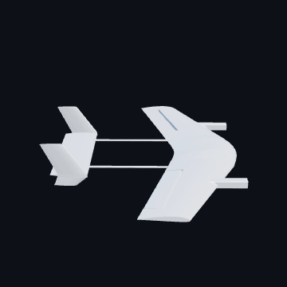

# Ori Algave

Mechanical and aerospace engineering student at the University of Florida. I design
rockets and airframes, and I build web tools for problems I actually have.

**[orialgave.com](https://orialgave.com)** · engineering projects, research, astrophotography

**Currently building:** [Lattice](https://joinlattice.app), getting UF students onto research teams. **On the engineering side:** CFD and flight-data analysis for the Swamp Launch rocket team, and carbon-fiber airframes for Gator Design/Build/Fly.

## Engineering

|  |  |
|:-:|:-:|
| **IREC competition rocket** Swamp Launch · SolidWorks, ANSYS Fluent | **Modular desktop wind tunnel** Personal project · 80+ hours of CAD, built from scratch |
|  |  |
| **eVTOL airframe** Gator Design/Build/Fly · carbon fiber | **Air-engine mixer** Machined and designed for DFM |

Click a model to open it in 3D.

## Projects

| Project | What it does | |
|---|---|---|
| **[Engineering CAD](https://github.com/0rb1/engineering-cad)** | Interactive 3D models from my rocket, aircraft and machine-design projects | [view in 3D](https://github.com/0rb1/engineering-cad) |
| **[Digital Wind Tunnel](https://github.com/0rb1/wind-tunnel)** | Live lattice-Boltzmann fluid simulation in the browser for learning aerodynamics | [run it](https://0rb1.github.io/wind-tunnel/) |
| **[Lattice](https://github.com/0rb1/lattice-public)** | Campus research marketplace connecting UF students and professors | [joinlattice.app](https://joinlattice.app) |
| **[Sites by Ori](https://github.com/0rb1/sites-by-ori-public)** | My student-run web design studio: custom sites for students and small businesses | [sitesbyori.com](https://sitesbyori.com) |

Also building, privately: an AI-assisted internship search tool, a study app for
engineering coursework, and an investment research dashboard.

## Activity

<picture>
  <source media="(prefers-color-scheme: dark)" srcset="dist/snake-dark.svg">
  
</picture>

<picture>
  <source media="(prefers-color-scheme: dark)" srcset="profile-3d-contrib/profile-night-green.svg">
  
</picture>

## Tools

SolidWorks · ANSYS Fluent · MATLAB · TypeScript · Next.js · React · PostgreSQL · Python
