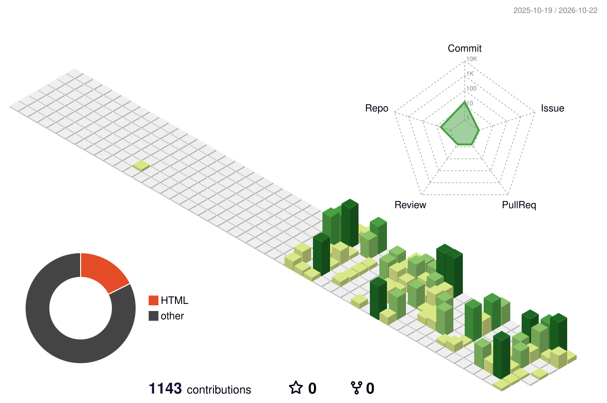

# Ori Algave

Mechanical and aerospace engineering student at the University of Florida. I build
web tools for problems I actually have: finding internships, studying for exams,
getting students onto research teams.

**[orialgave.com](https://orialgave.com)** · engineering projects, research, astrophotography

**Currently building:** [Lattice](https://joinlattice.app), getting UF students onto research teams. **On the engineering side:** CFD and flight-data analysis for the Swamp Launch rocket team, and carbon-fiber airframes for Gator Design/Build/Fly.

## Projects

| Project | What it does | |
|---|---|---|
| **[Engineering CAD](https://github.com/0rb1/engineering-cad)** | Interactive 3D models: IREC rocket, wind-tunnel rig, eVTOL airframe, air-engine mixer | [view in 3D](https://github.com/0rb1/engineering-cad#swamp-launch-rocket-design-and-cfd) |
| **Lattice** | Campus research and teams marketplace for UF students and professors | [joinlattice.app](https://joinlattice.app) |
| **Internship Scout** | Finds mechanical/aerospace internships every day, scores them, and tailors a resume to each | private |
| **[Digital Wind Tunnel](https://github.com/0rb1/wind-tunnel)** | Live lattice-Boltzmann fluid simulation in the browser for learning aerodynamics | [run it](https://0rb1.github.io/wind-tunnel/) |
| **Dynamics Desk** | Study app for engineering Dynamics: lessons, worked solutions, calculation labs | private |
| **Market Scout** | Evidence-first investment research dashboard with cited bull and bear cases | private |

## Sites by Ori

A student-run web design studio. Client work includes
[Waffles & Boba](https://waffles-and-boba.vercel.app) and Evren Technologies.

## Activity

<picture>
  <source media="(prefers-color-scheme: dark)" srcset="dist/snake-dark.svg">
  
</picture>

<picture>
  <source media="(prefers-color-scheme: dark)" srcset="profile-3d-contrib/profile-night-green.svg">
  
</picture>

## Tools

TypeScript · Next.js · React · PostgreSQL · Prisma · Supabase · Python · SolidWorks
